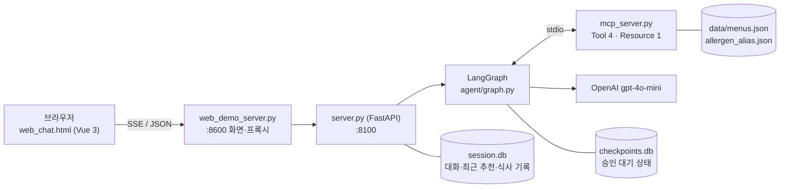
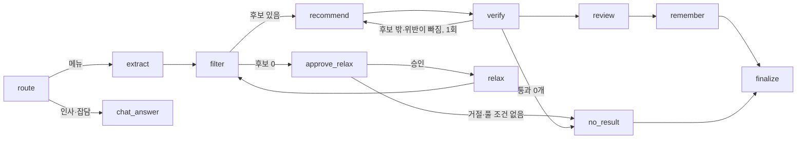
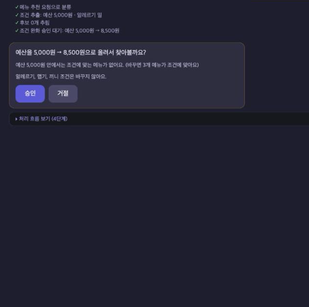
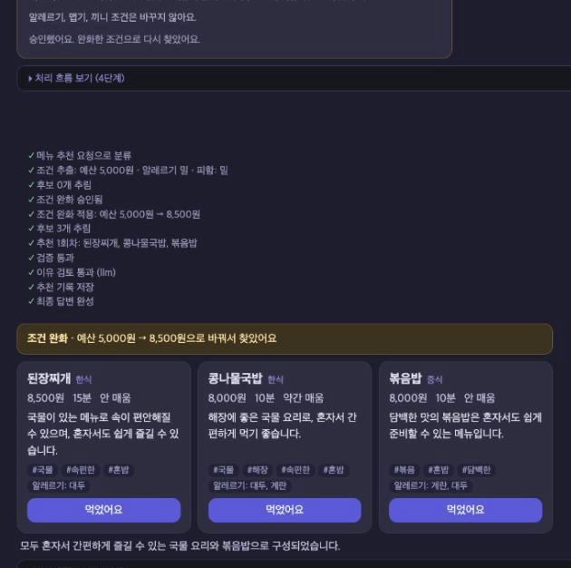
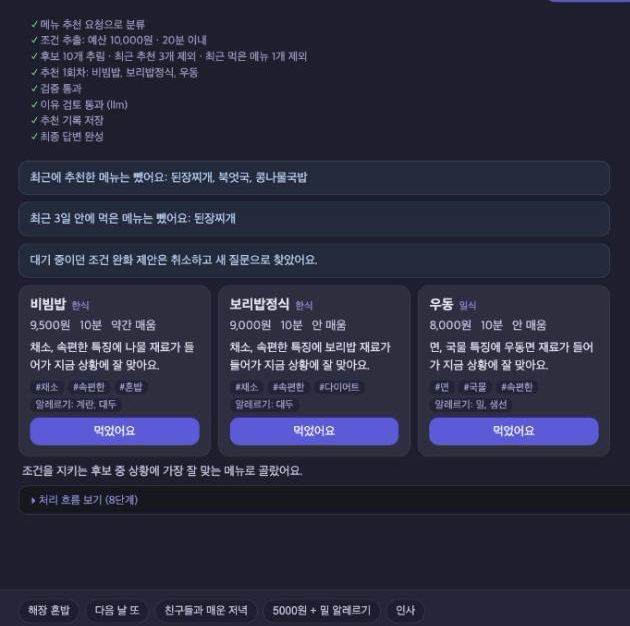

# 오늘뭐먹지 — 메뉴 추천 AI Agent

AI 서비스 개발 Mini-project 과제 2(신규 서비스) 결과물이다. 이전 과제 노트북에서 만든 메뉴 추천 LangGraph 를 강의 sample(`all_total_vue_student`) 구조 위로 옮겨 브라우저에서 실제로 쓸 수 있는 서비스로 만들었다.

## 1. 프로젝트명과 주제 선정 배경

이름은 "오늘뭐먹지"다. 식사 상황을 한 문장으로 적으면 조건에 맞는 메뉴를 최대 3개, 이유와 함께 추천한다.

```
돈이 없어서 5000원 안쪽으로 먹어야 해. 근데 밀가루 알레르기 있어서 면이랑 빵은 못 먹어
→ 예산을 8,500원으로 올려서 찾아볼까요? [승인]
→ 된장찌개, 콩나물국밥, 볶음밥 (이유 포함)
```

점심·저녁 메뉴 고르기는 매일 하는 일인데 예산, 시간, 알레르기, 맵기, 끼니를 한꺼번에 따져야 한다. 검색이나 앱 필터는 조건을 하나씩 골라야 하고 알레르기는 메뉴마다 직접 확인해야 한다. 일반 챗봇은 그럴듯하게 답하지만 알레르기 재료가 든 메뉴가 섞여도 막는 장치가 없다. 그래서 조건을 체크박스 대신 말로 적는 직장인과 학생을 사용자로 잡았다. 목표는 네 가지다. 한 문장으로 메뉴 3개와 이유를 받는다. 알레르기 메뉴는 어떤 경로로도 나오지 않는다. 조건을 바꿔야 하면 먼저 묻는다. 지난 추천과 먹은 것은 기억해서 뺀다.

이전 과제(AI Agent 설계 및 구축)에서 같은 주제로 노트북을 만들었다. 조건 추출은 LLM 이 하고 알레르기·예산 판정은 코드가 하는 구조까지는 노트북에서 확인했다. 다만 노트북 10절에 한계를 몇 가지 적어 두고 끝냈다. 이번 과제에서 그 한계를 실제로 고치고 고친 효과를 같은 입력으로 다시 재 보기로 했다.

## 2. 해결할 문제

노트북 10절에 적어 둔 한계는 다섯 가지다.

1. 예산·시간 조건을 사용자에게 묻지 않고 풀었다.
2. 이유 문장을 검사하지 않았다. 맵기 2 인 제육볶음을 "매운맛이 강하다" 고 써도 그대로 나갔다.
3. 최근 추천을 MemorySaver 에 두어서 프로세스가 재시작되면 잊었다.
4. 메뉴 36개가 코드에 박혀 있었다.
5. 추천 프롬프트에서 완화 내역 칸을 뺐더니, 모델이 사용자 문장의 5000원을 믿고 완화로 들어온 된장찌개(8500원)를 뺐다.

이번에 작업하면서 두 가지를 더 찾았다.

6. verify 가 조건만 검사해서 LLM 에 준 후보 목록 밖의 메뉴(case1 의 짜장면)도 조건만 맞으면 통과했다.
7. 알레르기 표기 사전이 "해산물" 을 새우 하나로만 바꿨다. 조개가 든 순두부찌개가 해산물 알레르기 사용자에게 추천됐다.

## 3. 개발 환경과 기술 스택

| 구분 | 사용한 것 |
|---|---|
| 언어·환경 | Python 3.11 (`.venv`), macOS |
| API 서버 | FastAPI 0.159.1, uvicorn 0.54.0, SSE |
| Agent | LangGraph 1.2.16, `interrupt()` / `Command(resume=...)` |
| 체크포인터 | langgraph-checkpoint-sqlite 3.1.2 (AsyncSqliteSaver), aiosqlite 0.22.1 |
| 데이터 연동 | MCP (fastmcp 4.1.3, mcp 2.3.0, stdio) |
| 저장소 | SQLite (`session.db`, `checkpoints.db`) |
| LLM | OpenAI gpt-4o-mini, temperature 0 (httpx 로 직접 호출, JSON 모드). 개발·테스트는 fake LLM |
| 화면 | Vue 3.5.13 (CDN, 단일 파일 `web_chat.html`) |
| 테스트 | pytest 9.1.1, node (화면 함수 검사) |
| 추적 | LangSmith (선택, 기본 꺼짐) |

## 4. 시스템 아키텍처



그래프는 노드 12개다. 판정(알레르기·맵기·끼니·최근 추천·예산·시간)은 `agent/rules.py` 의 함수가 하고, LLM 은 조건 추출, 후보 안에서 고르기, 이유 쓰기만 맡는다.



루프 상한은 State 카운터로 둔다. 완화는 2회, 재추천은 1회까지다.

sample 에서 가져온 것과 바꾼 것은 아래와 같다. sample 은 운영 장애 진단 에이전트였다.

| 구분 | 파일·구조 | 내용 |
|---|---|---|
| 그대로 씀 | `agent/retry.py`, lifespan 싱글턴, `SupervisorDeps` + `partial` 주입, SSE 스트리밍, MCP stdio 연결, `messages` 테이블, `run.sh` 하나로 실행 | 구조와 관례를 그대로 따랐다 |
| 바꿈 | `server.py`, `agent/graph.py`, `agent/deps.py`, `agent/*_llm.py`, `agent/mcp_client.py`, `agent/session_store.py`, `mcp_server.py`, `web_chat.html`, `web_demo_server.py` | 장애 진단 노드 10개와 엔드포인트를 메뉴 추천용으로 바꿨다. route·chat_answer·finalize 는 남겼다 |
| 지움 | `agent/supervisor_v1.py`, `mcp_server_docs.py`, `data/monitoring.json`, `data/runbooks/`, `doc/manual_*.md`, `doc/image_usecase*/` | 장애 진단 전용 |
| 새로 만듦 | `agent/rules.py`, `agent/state.py`, `agent/schemas.py`, `agent/prompts.py`, `agent/nodes/`, `agent/menu_repo.py`, `agent/meal_db.py`, `data/menus.json`, `data/allergen_alias.json`, `tests/`, `eval/` | 노트북 이식, HITL, reviewer, 기록, 테스트, 실측 |

## 5. 주요 기능

- 문장 → 조건: LLM 이 예산(1인 기준)·시간·맵기·알레르기·끼니를 뽑는다. 알레르기 표기는 코드가 데이터에 맞춘다. 밀가루는 밀로, 해산물은 새우·오징어·조개·생선으로 바꾼다.
- 코드 판정: 알레르기·맵기·끼니·최근 추천·최근 먹은 메뉴는 `block_reason`, 예산·시간은 `over_limit` 가 판정한다. filter 와 verify 가 같은 함수를 쓴다. LLM 이 무엇을 골라도 verify 를 거쳐야 결과에 들어간다.
- 완화 전에 승인: 후보가 0개면 "예산을 5,000원 → 8,500원으로 올려서 찾아볼까요?" 를 묻고 멈춘다. 승인하면 그 값으로 다시 찾고, 거절하면 끝낸다. 알레르기·맵기·끼니는 풀지 않는다.
- 이유 검증: review 노드가 이유 속 맵기·국물 표현을 메뉴 데이터와 대조한다. 틀리면 데이터로 만든 문장으로 바꾸고 `review_flags` 에 남긴다. 기본은 규칙 판정(`REVIEW_MODE=rules`)이고 LLM 판정(`llm`)은 옵션이다.
- 재시작해도 기억: 최근 추천 6개와 식사 기록은 `session.db`, 승인 대기 상태는 `checkpoints.db` 에 둔다.
- 먹었어요·식사 기록: 카드의 "먹었어요" 버튼으로 기록한다. 최근 3일 안에 먹은 메뉴는 다음 추천에서 뺀다. 오른쪽 패널에서 최근 7일 기록을 본다.
- 일반 대화: 인사나 이름 소개는 route 가 chat 으로 보내고 대화 기록으로 이름을 기억한다(sample 기능 유지).
- 처리 흐름 보기: 노드마다 이벤트 하나를 SSE 로 보내 화면에 단계별로 보여 준다.

API 는 `POST /chat`, `GET /chat/stream`, `POST /chat/resume`, `GET /chat/pending`, `POST·GET /meals`, `GET /health`, `GET /graph` 다. MCP Tool 은 `list_menus`, `get_menu`, `get_meal_history`, `save_meal`, Resource 는 `menu://allergens` 다.

주요 변경 파일:

| 파일 | 역할 |
|---|---|
| `agent/graph.py` | 노드 등록과 조건부 엣지만 둔다. `build_graph(deps, checkpointer)` |
| `agent/rules.py` | 판정 함수, 알레르기 정규화, 완화 값 계산(노트북 5-2, 5-6 이식) |
| `agent/nodes/relax.py` | `approve_relax`(제안 계산 후 `interrupt()`), `relax`(승인된 값 적용) |
| `agent/nodes/verify.py` | 데이터에 없는 이름·후보 밖 메뉴·조건 위반을 뺀다 |
| `agent/nodes/review.py` | 이유 검증. rules → (선택) LLM 판정 |
| `agent/menu_repo.py`, `agent/mcp_client.py`, `mcp_server.py` | 그래프는 `menu_repo` 만 안다. MCP 가 실패하면 로컬 JSON 으로 폴백 |
| `agent/session_store.py`, `agent/meal_db.py` | `messages`, `recommendations`, `meals` 테이블 |
| `server.py` | 엔드포인트, 체크포인터·MCP 조립, resume 전에 대기 여부 확인 |
| `web_chat.html` | 추천 카드, 승인/거절, 먹었어요, 식사 기록, 처리 흐름 |
| `eval/baseline_notebook.py`, `eval/run_before_after.py` | Before 재현과 실측 |

## 6. 실행 방법

처음 한 번 가상환경을 만든다.

```bash
python3.11 -m venv .venv
./.venv/bin/pip install -r requirements.txt
cp .env.example .env
```

fake 모드(기본, API 키 필요 없음, 과금 없음):

```bash
bash run.sh
```

브라우저에서 http://localhost:8600 을 연다. 종료는 Control + C 다. fake LLM 은 문장 키워드로 조건을 뽑고 후보 앞에서 3개를 고른다. 화면과 흐름을 확인하는 용도다.

OpenAI 모드(과금 발생):

1. `.env` 의 `OPENAI_API_KEY=` 에 본인 키를 넣는다. 키가 든 `.env` 는 커밋하지 않는다.
2. `LLM_BACKEND=openai bash run.sh` 로 실행한다. `.env` 의 `LLM_BACKEND` 를 openai 로 바꿔도 된다. 그러면 `bash run.sh` 만 쳐도 과금 모드로 뜨니 주의한다.

`run.sh` 는 키가 비어 있거나 8100·8600 포트가 이미 쓰이고 있으면 멈춘다. 그 밖의 설정은 `.env.example` 에 있다(`REVIEW_MODE`, `CHECKPOINTER`, `MENU_REPO`, `FAKE_LLM_MODE` 등). 시연 동선은 case3 입력 → 승인 → 먹었어요 → 서버 재시작 → 같은 요청을 다시 보내 직전 추천이 빠지는지 확인하는 순서다.

테스트와 실측:

```bash
./.venv/bin/python3 -m pytest tests -q                                   # fake LLM, 네트워크 없음
./.venv/bin/python3 eval/run_before_after.py --llm fake                  # 실측 파이프라인 확인
./.venv/bin/python3 eval/run_before_after.py --llm openai --dry-run      # 예상 호출 수만
./.venv/bin/python3 eval/run_before_after.py --llm openai --reps 2       # 실측 (과금)
```

## 7. 테스트 결과와 실행 화면

개발과 테스트는 fake LLM 으로 했다. 실제 OpenAI 는 스모크 테스트와 Before/After 실측에만 썼다.

| 무엇을 | 결과 | 내용 |
|---|---|---|
| pytest (fake LLM, 네트워크 없음) | 140 passed, 0 failed | 규칙, 그래프 경로, API, MCP, 화면 경계, 데이터 무결성. 27초 |
| 회귀 문장 라이브 실행 (fake, 8600 경유) | 22 / 22 통과 | 노트북 case1~3, 해산물 알레르기, 예외 입력, 재시작 전후 |
| 승인 대기 중 서버 재시작 | 대기 유지 | 다시 켠 뒤 `/chat/pending` 이 true → 승인 → 추천 완료 |
| 같은 승인을 두 번 보냄 | 두 번째는 409 | 대기가 없으면 `NO_PENDING_APPROVAL` 로 막는다 |
| OpenAI 스모크 (gpt-4o-mini) | 4 / 4 통과 | case1·case2·case3·승인. 호출 12회, 폴백 0 |

모든 API·그래프 테스트에 같은 안전 검사(`tests/conftest.py` 의 `assert_safe`)를 건다. 알레르기 정답은 시스템 사전이 아니라 사람이 손으로 적은 표(`EXPECTED_BLOCK`)에서 가져온다. 재료 → 알레르기 대응표(`INGREDIENT_ALLERGENS`)로 메뉴 데이터도 따로 검사한다.

| 승인 요청 | 승인 후 결과 (OpenAI) | 재방문 |
|---|---|---|
|  |  |  |
| 후보가 0개라 5,000원 → 8,500원을 제안한다 | 완화 내역은 코드가 첫 줄에 쓴다 | 직전 추천 3개와 먹은 메뉴를 빼고 추천한다 |

## 8. Before / After

Before 는 노트북 최종본 코드를 `eval/baseline_notebook.py` 에 그대로 옮긴 것이다. 데이터도 노트북에서 그대로 뽑았다(`eval/before_data/`, 해산물 → 새우 사전과 북엇국 생선 누락 포함). After 는 이번 서비스 그래프다. 같은 21문장(`eval/queries.jsonl`, 알레르기 정답은 손으로 적음)을 같은 모델(gpt-4o-mini, temperature 0)로 두 번씩 돌렸다. 재방문 시나리오는 1회째와 2회째 사이에 프로세스를 재시작한 상태를 만든다. Before 는 그래프를 새로 만들고, After 는 같은 DB 파일을 다시 연다.

| 지표 | Before (노트북) | After | 메모 |
|---|---|---|---|
| 알레르기 위반 메뉴 (단일 요청) | 3 | 0 | 북엇국 2(데이터 누락), 우동 1(해산물→새우 사전) |
| 해산물 문장에서 알레르기 정규화 누락 | 4 / 4 | 0 / 4 | Before 는 "해산물" 을 새우로만 바꿨다 |
| 재시작 후 직전 추천과 겹친 비율 | 0.963 / 0.926 | 0 | 재방문 10문장. Before 는 MemorySaver 가 비었다 |
| 승인 없이 예산·시간을 푼 실행 | 3 | 0 | After 는 3번 모두 먼저 묻고 풀었다 |
| 응답 시간 중앙값 (ms) | 4,891 / 4,526 | 5,398 / 5,104 | 나빠짐. 약 10~13% 늘었다 |
| 요청당 LLM 호출 수 | 1.95 | 2.95 | 나빠짐. route 분류 호출이 1번 더 있다 |

"a / b" 는 1회차 / 2회차 값이고, 하나만 적은 칸은 두 번 다 같았다. After 는 MCP·SQLite·`REVIEW_MODE=rules` 로 돌렸고 승인 요청은 측정 스크립트가 자동으로 승인했다. Before 는 노트북 코드 그대로이고 비교를 맞추려고 LLM 전송만 After 와 같은 JSON 모드로 바꿨다(노트북은 `with_structured_output`).
LLM 판정 reviewer(after_llm)는 1차 측정을 재사용한 것이고 북엇국 데이터를 보정하기 전에 돌렸다. 응답 시간 중앙값은 7,470 / 7,292ms, 호출은 3.9회였다. 그래서 이 값은 지연·호출 수 비교에만 쓴다.

출처: [`eval/results/2026-10-22_openai_final_summary.md`](eval/results/2026-10-22_openai_final_summary.md). 실행 행 전체는 같은 폴더의 `_runs.jsonl` 에 있다. 실측에 쓴 실제 호출은 1차 366회, 재측정 184회다.

채점은 `.claude/skills/menu-before-after-eval/scripts/score_results.py` 로 했다. 이유 문장 오류율은 Before·After 모두 0 으로 나왔다. 규칙 채점이라 놓치는 표현이 있고 이유가 상황과 약하게 이어지는 문제는 이 지표로 잡히지 않는다(10절).

## 9. 문제점과 해결

- 해산물 알레르기 누출. 처음에는 알레르기 사전이 "표기 하나 → 재료 하나" 라서 해산물이 새우로만 바뀌었고 조개가 든 순두부찌개가 추천됐다. 더 문제였던 건 테스트가 이걸 못 잡은 것이다. 안전 검사가 응답의 `constraints.allergies`(시스템이 정규화한 값)를 기준으로 삼아서 시스템과 같이 틀렸다. 사전 값에 리스트를 허용해 4종으로 펼쳤다. 테스트 기대값은 사람이 적은 정답표로 바꿨다.
- 후보 밖 메뉴 통과. 노트북 verify 는 조건만 봐서 상위 10개 후보에 없던 짜장면이 조건만 맞아 통과했다. 이번 요청의 후보 이름 집합에 없으면 "후보 목록 밖 메뉴" 로 빼고 재추천하게 했다.
- 북엇국 생선 누락. Before/After 1차 실측 결과를 읽다가 해산물 알레르기 문장에 북엇국이 계속 나오는 걸 봤다. 재료는 북어(생선)인데 allergens 에 생선이 없었다. 판정·채점·테스트가 모두 같은 데이터를 믿어서 아무도 못 잡았다. 데이터를 고치고(`extract_notebook.py` 의 `MENU_ALLERGEN_FIXES`), 재료 → 알레르기 대응표로 메뉴 데이터를 검사하는 테스트(`tests/test_data_integrity.py`)를 넣었다. After 는 보정한 데이터로 다시 쟀다.
- LLM 판정 reviewer 오탐. 1차 실측에서 LLM 판정이 낸 30건을 직접 읽어 보니, 데이터와 실제로 어긋난 건 5건쯤이었다. 나머지 25건쯤은 "밀가루가 포함되지 않아" 처럼 맞는 이유를 모순이라고 해서 템플릿 문장으로 바꿔 버렸다. 호출도 1번 늘고 지연도 컸다. 기본값을 규칙 판정으로 바꾸고 LLM 판정은 옵션으로 남겼다.
- 채점기 오탐. 이유 채점 규칙이 "매운 맛이 없어 맵찔이에게" 의 '맵찔이' 를 '맵다' 로 읽었다. 1차 실측의 이유 오류 6건이 모두 이 경우였다. 모든 등장 위치를 보고 '맵찔' 로 시작하는 자리는 건너뛰게 고쳤다.
- 체크포인터. sample 그래프는 `ainvoke`/`astream` 을 쓰는 async 라서 sync `SqliteSaver` 를 쓸 수 없었다. `AsyncSqliteSaver` 를 쓰고 파일은 `session.db` 와 나눠 `checkpoints.db` 로 뒀다. 같은 파일에 aiosqlite 와 sync sqlite3 쓰기가 섞이면 잠금 교착이 날 수 있어서다.
- 대기 없는 resume. LangGraph 는 대기 중인 interrupt 가 없는 thread 에 `Command(resume=...)` 를 보내도 오류 없이 START 부터 빈 입력으로 돈다. server 가 resume 전에 `aget_state` 로 대기 여부를 확인하고 없으면 409 를 돌려주게 했다.
- 풀 조건이 없을 때 화면 문구. 예산·시간 조건이 아예 없으면 묻지 않고 끝나는데, 화면이 이걸 "조건 완화 거절됨" 으로 보여 줬다. 사용자는 아무것도 거절하지 않았다. 이벤트의 `approved` 를 null 로 두고 화면 문구를 따로 만들었다.

## 10. 한계와 향후 방향

- 이유 문장이 사용자 상황과 약하게 이어진다. 돈이 없고 밀 알레르기가 있다는 문장에도 "혼자서 간편하게" 같은 말이 반복된다. review 는 데이터와의 모순만 보기 때문에 이 문제는 못 잡는다.
- 규칙 판정 reviewer 는 맵기·국물 표현만 본다. 데이터에 없는 재료를 지어내는 경우는 놓친다. LLM 판정은 오탐이 많아서 지금은 옵션으로만 둔다.
- 실모델에서는 "어제 치킨" 에서 닭고기 회피가 추출되지 않았다(노트북 추출 규칙 2). 이번 결과에는 영향이 없었다.
- LLM 을 동기 httpx 로 호출해서 응답을 기다리는 동안 서버 전체가 멈춘다. 노드에서 `asyncio.to_thread` 로 감싸면 인터페이스를 그대로 두고 풀 수 있다.
- After 는 Before 보다 응답이 10% 남짓 느리고 호출이 1회 많다(route 분류). 승인이 필요하면 왕복도 한 번 더 생긴다. 승인하지 않고 떠나면 대기 중인 thread 가 남는다. 다음 요청이 오면 대기를 취소하지만 따로 정리하는 정책은 없다.
- SQLite 단일 파일이라 동시 쓰기에 약하다. 사용자는 브라우저 localStorage 의 id 로만 구분한다.
- MCP 때문에 프로세스 경계가 하나 늘었다. 실패하면 로컬 JSON 으로 폴백하는데, 그 사이 데이터가 바뀌면 둘이 어긋날 수 있다.
- RAG 와 Multi-Agent 는 넣지 않았다. 메뉴가 36개라 검색할 문서가 없고, LLM 이 판단하는 지점도 추출과 추천 두 곳뿐이라 에이전트를 나눌 이유가 없었다.
- 데이터가 틀리면 코드 판정도 같이 틀린다. 북엇국 건처럼 데이터 검사는 사람이 적은 대응표에 기대고 있다. 메뉴를 늘리면 이 표도 같이 늘려야 한다.

발표 자료는 [`doc/presentation.pdf`](doc/presentation.pdf), 개요는 [`doc/presentation_outline.md`](doc/presentation_outline.md) 에 있다.
